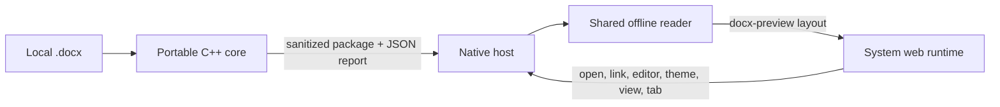

# LeanDoc technical specification

Status: accepted for v0.1.0
Date: 2026-10-20
Source plan: [HANDOFF.md](HANDOFF.md). Decisions: [docs/adr/](adr/README.md).

## 1. Product

**Promise:** Read the document, not the office suite.

LeanDoc is a focused, read-only desktop viewer for Word documents. It opens a
`.docx` quickly, never runs anything inside it, never fetches anything the
document points to, and has one button that hands the file to a real editor.

Audiences, in order: people without Word (Windows 11 24H2 removed WordPad),
people with Word who only want to read, and people opening attachments they do
not trust.

### Decisions settled with the owner (2026-10-20)

| Question | Decision |
| --- | --- |
| Name | LeanDoc, package ID `abooodbah.LeanDoc`. Never "LeanWord". |
| Default view | Page view. Reading view is one click away and remembered. |
| `.doc` in v1 | Fallback page with the open-in-editor action. Research spike after v1. |
| Shared host library | Out of scope. Host code is copied from LeanMark and adapted. |
| Platforms | Windows x64, Linux x86-64 (.deb), macOS universal preview, as LeanMark. |

### Never

Editing, saving, macros, mail merge, network fetches, telemetry, accounts,
update checks.

## 2. Architecture

Hybrid, per [ADR 0001](adr/0001-rendering-engine.md):



- **Core** (`src/core/`, C++17, miniz + pugixml): reads the file within bounds,
  classifies it, validates the ZIP, parses XML with DTDs refused, counts every
  feature for the fidelity report, builds the outline, and writes a new
  sanitized package that contains only allow-listed parts. The contract is
  [`src/core/DocCore.h`](../src/core/DocCore.h).
- **Reader** (`assets/`): one HTML/CSS/JS page shared by all hosts. It fetches the
  sanitized package from the host, lays it out with a pinned copy of
  docx-preview, and adds the LeanDoc chrome: tabs, fidelity bar, outline,
  find, zoom, views, theme, and fallback pages.
- **Hosts:** Win32 + WebView2 (`src/windows/`), GTK 4 + WebKitGTK 6.0
  (`src/linux/`), AppKit + WKWebView (`macos/`). Copied from LeanMark 0.3.0
  and adapted. Hosts own files, dialogs, drag and drop, single instance, tabs
  state, settings, recent files, external links, open-in-editor, and web
  runtime policy.
- **leandoc-inspect** (`tools/inspect/`): a command-line front end for the core.
  `leandoc-inspect FILE...` prints one JSON report per line. `--folder DIR`
  walks a folder recursively. It is used by tests, the corpus run, and the
  owner's private smoke script. It never writes into the scanned folder.

Rendering stays in the web runtime because docx-preview already handles
styles, numbering, tables, headers, footers, notes, and right-to-left text, and
because all three hosts already have a hardened web runtime. Everything
security-relevant happens in native code before the reader sees a byte.

## 3. Core requirements

### 3.1 Reading and classification

- `OpenDocumentFile` accepts regular files only, enforces
  `Limits::maximumInputBytes` (256 MiB) before reading, and on Windows the host
  reads with `FILE_SHARE_READ | FILE_SHARE_WRITE | FILE_SHARE_DELETE` as
  LeanMark does, then calls `OpenDocumentBytes`.
- `DetectKind` uses content: `PK\x03\x04` (ZIP), `D0 CF 11 E0 A1 B1 1A E1`
  (OLE compound file; `EncryptionInfo` stream present means encrypted OOXML),
  `{\rtf` (RTF). A ZIP is OOXML Word only if `[Content_Types].xml` names a
  main document part with one of the four Word content types. ODT is a ZIP
  whose `mimetype` entry is `application/vnd.oasis.opendocument.text`.

### 3.2 ZIP safety

Use miniz for the central directory and inflate, with our own bounds:

- at most 4,096 entries; reject duplicate names (case-insensitive) and names
  that are absolute, contain `..` segments, backslashes, drive letters, NUL, or
  are longer than 512 bytes;
- reject encrypted entries and unsupported compression methods (only stored and
  deflate);
- trust neither the declared sizes nor the CRC alone: inflate with an output
  cap equal to `min(declared size, maximumPartBytes)` and fail if the stream
  produces more; check the CRC;
- enforce the running total against `maximumTotalUncompressedBytes` and the
  compression ratio for entries over 1 MiB;
- inflate only parts that are needed (allow-listed or required for analysis).

### 3.3 XML safety

Use pugixml with `parse_default & ~parse_doctype` behaviour hardened as
follows: any part containing `<!DOCTYPE` or `<!ENTITY` fails with
`xml-doctype` before parsing. pugixml never loads external resources. Element
depth is bounded by `maximumXmlDepth`. Namespaces are matched by URI, not by
prefix (prefixes in OOXML are conventional, not fixed).

### 3.4 Analysis

One pass over every story part (document, headers, footers, footnotes,
endnotes) and the relationship parts counts each `Feature` in `DocCore.h`.
Also detect `vbaProject.bin`, macro-enabled content types,
`settings.xml` `w:attachedTemplate` with an external relationship, all
`TargetMode="External"` relationships by type, `r:link` on `a:blip` and
`v:imagedata`, `w:fldSimple` and `w:instrText` fields (`INCLUDEPICTURE`,
`INCLUDETEXT`, `LINK`, `DDE`, `DDEAUTO`), `w:altChunk`, `w:object`, ActiveX
parts and `w:control`, embedded font elements, and comments.

### 3.5 Sanitized package

The reader never receives the original file. The core writes a new ZIP
(stored or deflate) containing only:

- `[Content_Types].xml`, `_rels/.rels`, the main document part and its rels;
- styles, stylesWithEffects, numbering, theme, settings, fontTable (with embed
  elements removed), webSettings, footnotes, endnotes, headers, footers,
  `docProps/core.xml`;
- images referenced by `r:embed` with content type PNG, JPEG, GIF, BMP, TIFF,
  EMF, WMF (SVG is dropped; Word stores a PNG fallback beside it).

In the retained XML:

- every relationship with `TargetMode="External"` is removed, except hyperlinks
  whose target scheme is `http`, `https`, or `mailto`;
- `w:attachedTemplate`, `r:link` image references, `w:altChunk`, `w:object`,
  `w:control`, comment anchors, and embedded font references are removed;
- tracked changes are accepted: `w:del`, `w:moveFrom`, and `*PrChange`
  elements are dropped; `w:ins` and `w:moveTo` are unwrapped;
- `INCLUDEPICTURE`, `INCLUDETEXT`, `LINK`, and `DDE*` field codes keep their
  cached result text only.

The sanitized package must open in LibreOffice headless as a valid document
(tested in CI on Linux).

### 3.6 Outline and properties

The outline lists paragraphs whose effective outline level (direct `w:outlineLvl`,
else the style chain through `w:basedOn`) is 0 to 8, in document order, with
`paragraphIndex` counted over body `w:p` elements including those in tables.
`rightToLeft` is true when the default paragraph style or the first non-empty
body paragraph is `w:bidi`.

### 3.7 Performance budget (core)

On the CI Linux runner, `OpenDocumentFile` on the generated 300-page fixture
completes in under 500 ms and peaks under 64 MiB resident for the CLI. The
corpus run reports any file over 2 s.

## 4. Reader requirements

The reader is adapted from LeanMark's `assets/` and keeps its structure:
one IIFE, no framework, no build step, a host bridge that uses
`window.chrome.webview` or `window.webkit.messageHandlers.leandoc`, and host
messages arriving as a `leandoc-message` DOM event.

### 4.1 Rendering

- Vendor `docx-preview` 0.4.1 (Apache-2.0) and `jszip` 3.10.2 (used under MIT)
  from npm at build time, pinned in `package-lock.json`, staged by
  `scripts/stage-runtime-assets.mjs`.
- Fetch the sanitized package from `document.packageUrl` (same origin as the
  reader), then `docx.renderAsync` with `inWrapper: true`,
  `ignoreLastRenderedPageBreak: false`, `experimental: true`,
  `renderComments: false`, `renderChanges: false`, `useBase64URL: false`
  (images become `blob:` URLs, revoked when the tab is replaced).
- **Page view (default):** docx-preview pages on a soft stone canvas, page
  shadow, zoom via CSS `zoom` with 50 to 300 percent and "fit width".
  Sections use `content-visibility: auto` so a 300-page document scrolls
  smoothly.
- **Reading view:** the same render with `ignoreWidth: true`,
  `ignoreHeight: true`, `breakPages: false`, headers and footers hidden,
  content width capped near 72 characters, reflowing to the window.
- The document page always stays on paper colours, in every chrome theme.
- **Post-processing fixes**, each with a fixture and a test:
  - Symbol, Wingdings, and Webdings private-use bullet characters
    (U+F0xx) map to Unicode equivalents (U+F0B7 to "•", U+F0A7 to "▪",
    U+F0D8 to "➢", U+F0FC to "✓", "o" in Courier New stays "o");
  - right-to-left paragraphs, lists, and `w:bidiVisual` tables render mirrored
    (verified with Arabic fixtures);
  - every `a[href]` is rewritten to a click handler that posts `link` to the
    host; nothing navigates inside the reader.

### 4.2 Chrome

Top bar like LeanMark: wordmark, file name and details, find field, view toggle
(Page / Reading), zoom control, theme button (System, Light, Dark cycle),
"Open in ..." button labelled with the editor the host found, Open button.
Below it the tab strip (hidden for one tab) and the fidelity bar.

- **Fidelity bar:** a quiet bar above the page, never a modal. Sentence 1 lists
  not-displayed features with counts, for example "This document contains 2 text
  boxes and 1 equation that LeanDoc does not display." followed by the
  open-in-editor action. Sentence 2 lists notices: "It also contains tracked
  changes (shown as accepted), comments (hidden), and macros (not run)." Remote
  items read "(not fetched)". A details disclosure lists every feature and
  count. The bar can be collapsed per tab, never dismissed forever.
- **Navigation pane** built from `outline`, matched to rendered paragraphs by
  `paragraphIndex`; collapsible; hidden when the outline is empty.
- **Find:** LeanMark's text-node search over the rendered document, with match
  count, Enter / Shift+Enter, F3, and Escape. Searching reading view and page
  view gives the same count.
- **Copy:** native selection copy, plus Ctrl+Shift+C to copy all text.
- **Fallback page** for `legacy-doc`, `encrypted-ooxml`, `rtf`, `odt`,
  `not-a-document`, and every core error: one sentence on what the file is and
  why LeanDoc does not show it, and the open-in-editor action.
- **Empty state:** "Read Word documents without opening an office suite." with
  Open and a list of up to 10 recent files (local only) and "Clear recent".
- Keyboard: Ctrl+O, Ctrl+F, F3, Ctrl++ / Ctrl+- / Ctrl+0, Ctrl+Shift+T (theme),
  Ctrl+Shift+V (switch view), Ctrl+Shift+E (open in editor), Ctrl+Tab,
  Ctrl+W, Ctrl+1..9, F5 reload. Command on macOS.
- Accessibility: every control has a name, focus is visible, the fidelity bar is
  announced once per document through a polite live region.

### 4.3 Reader and host protocol

Messages are JSON objects with a `type`.

Host to reader:

| type | fields |
| --- | --- |
| `host` | `platform`, `version`, `editor` {`kind`: `word`, `libreoffice`, `pages`, `default`, `web`; `label`}, `tabs` (bool) |
| `theme` | `theme` (`system`, `light`, `dark`), `view` (`page`, `reading`) |
| `tabs` | `tabs` [{`id`, `name`, `path`}], `active` |
| `document` | `tab`, `generation`, `fileName`, `displayPath`, `packageUrl`, `report` (the `ReportToJson` object) |
| `fallback` | `tab`, `fileName`, `displayPath`, `report` |
| `empty` | `recent` [{`path`, `name`}] |
| `status` | `message`, `tone` (`info`, `warning`, `error`) |

Reader to host: `ready`, `open`, `openRecent` {`path`}, `clearRecent`,
`openInEditor` {`tab`}, `link` {`href`}, `setTheme` {`theme`}, `setView`
{`view`}, `selectTab` {`id`}, `closeTab` {`id`}, `reload`, `rendered` {`tab`,
`generation`, `pages`, `ms`}, `renderFailed` {`tab`, `generation`, `message`}.

The host ignores `rendered` and `renderFailed` for a stale generation.

### 4.4 Content Security Policy

```text
default-src 'none'; script-src 'self'; style-src 'self' 'unsafe-inline';
font-src 'self'; img-src 'self' blob: data:; connect-src 'self';
object-src 'none'; frame-src 'none'; worker-src 'none'; form-action 'none';
base-uri 'none'
```

`unsafe-inline` styles are required because docx-preview writes the document's
styles into `<style>` elements; scripts stay `'self'` only. The package URL is
same-origin with the reader, so `connect-src 'self'` reaches nothing else.

## 5. Host requirements

Common to all hosts:

- Serve reader assets from a read-only app origin and the sanitized package of
  each tab at `<app origin>/pkg/<tab>/<generation>/document.docx`, answered from
  memory. Unknown paths answer 404. No document directory is mapped.
- Block navigation away from the app origin, new windows, downloads,
  permission requests, and script dialogs.
- `link`: only `http`, `https`, and `mailto`, opened by the OS handler after a
  click, never inside the reader, never through a shell.
- **Open in editor:** resolve once per launch and report the label in `host`.
  Order: Microsoft Word, then LibreOffice, then the system default handler for
  the extension if it is not LeanDoc itself, then Word for the web in the
  browser (`https://www.office.com/launch/word`, with a status message
  explaining that the file must be uploaded there). macOS also checks Pages
  after LibreOffice. Launch with an argument vector, never a shell string.
- Single instance: a second launch hands its paths to the running window and
  exits (Windows `WM_COPYDATA` as LeanMark; Linux `GApplication` with
  `G_APPLICATION_HANDLES_OPEN`). macOS uses NSDocument windows with system
  window tabbing.
- Tabs keep only the path, file stamp, and generation. Background tabs keep no
  package or DOM; selecting a tab reads the file again.
- Reload when the active file changes on disk (poll or file monitor), keeping
  the reading position by ratio.
- Drag and drop of supported files, command-line paths, File > Open.
- Settings: theme, view, zoom, and up to 10 recent paths. Windows
  `HKCU\Software\LeanDoc`; Linux `$XDG_CONFIG_HOME/leandoc/settings.ini`;
  macOS `NSUserDefaults`. Nothing else is written.
- `--smoke-test FILE` renders FILE, waits for `rendered`, checks the DOM, and
  exits 0 or 1 within 20 s, as LeanMark does.
- Test hooks for the [test plan](TEST_PLAN.md), inert without their flags:
  `--trace-timing` prints `LEANDOC_TIMING <event> <ms since process start>`
  to stdout, flushed per line, for `process-start`, `window-visible`,
  `webview-ready`, `document-requested`, `package-served` (with core ms and
  bytes), and `rendered` (with pages and the reader's ms).
  `--exit-after-render=MS` quits cleanly MS milliseconds after the first
  `rendered`, so a harness can sample memory first. Web runtime processes stay
  descendants of the LeanDoc process where the platform allows, and
  `docs/architecture/hosts.md` describes the process tree on each platform.
- WebView2: re-measure LeanMark's browser arguments rather than copying them;
  keep tracking prevention off and one user-data folder per install with
  identical environment options.

Integration:

- Windows: optional `installer/install.ps1` (current user) copies to
  `%LOCALAPPDATA%\Programs\LeanDoc`, adds Start menu and Open With entries and
  Default Apps capabilities for `.docx .dotx .docm .dotm .doc .rtf .odt`, never
  writes `UserChoice`, and has `-ValidateOnly`; `uninstall.ps1` removes it.
- Linux: `.desktop` with MIME types, AppStream metainfo, hicolor icon.
- macOS: Info.plist document types for the same extensions (viewer role).

## 6. Security requirements and fixtures

Each line is a crafted file under `tests/fixtures/security/`, generated by
`tests/fixtures/make-fixtures.py` (python-docx plus `zipfile`), committed, and
asserted by core tests (and by the reader or host smoke where noted).

| Fixture | Expectation |
| --- | --- |
| `zip-bomb.docx` (one part inflating past the cap) | `part-too-large` or `compression-ratio`, no allocation past the cap |
| `many-entries.docx` (5,000 entries) | `too-many-entries` |
| `zip-slip.docx` (`../evil.xml`, `/abs.xml`, `a\\b.xml`) | `unsafe-entry-name` |
| `duplicate-entry.docx` | `duplicate-entry` |
| `truncated.docx` | `corrupt-zip` |
| `xxe.docx` (DOCTYPE with SYSTEM entity in document.xml) | `xml-doctype` |
| `billion-laughs.docx` | `xml-doctype` |
| `deep-nesting.docx` (300 nested elements) | `xml-too-deep` |
| `remote-template.docx` (attachedTemplate to `https://example.invalid/t.dotm`) | renders; `remote-template` notice; absent from sanitized package |
| `remote-image.docx` (`r:link` to `https://example.invalid/a.png`) | renders; `remote-image` notice; reader makes no request |
| `include-field.docx` (`INCLUDEPICTURE "https://..." \d`) | cached result only; `external-content` notice |
| `dde.docx` (`DDEAUTO`) | `dde-field` notice; field code absent from output |
| `macro.docm` (with `vbaProject.bin`) | renders; `macros` notice; no `vbaProject.bin` in sanitized package |
| `activex.docx`, `ole.docx` | `activex` / `ole-object` counts; payload parts removed |
| `altchunk.docx` (HTML with `<script>`) | `alt-chunk` count; HTML never reaches the reader |
| `hyperlinks.docx` (`https`, `mailto`, `javascript:`, `file:`) | only https and mailto survive; clicking posts `link` |
| `legacy.doc` (CFB signature) | `legacy-doc`, fallback page |
| `encrypted.docx` (CFB with EncryptionInfo) | `encrypted-ooxml`, fallback page |

The reader DOM tests also assert that a rendered document makes no request
outside the app origin.

## 7. Verification

- **Core tests** (`tests/core/`, C++, CTest) on all three CI operating systems.
- **Reader tests** (`tests/reader/`, Node + Playwright Chromium with a fake host
  bridge) on Linux CI: rendering of each feature fixture, fidelity bar text,
  outline, find, zoom, view switch, tabs, fallback pages, CSP violations zero,
  zero off-origin requests.
- **Host smoke:** Linux `xvfb-run` + `dbus-run-session` with `--smoke-test` on
  real WebKitGTK; Windows `--smoke-test` on WebView2; macOS `--smoke-test` on
  WKWebView. Windows static and package tests in `tests/Test-LeanDoc.ps1`.
- **Feature fixtures** (`tests/fixtures/features/`, generated): styles and
  inheritance, theme fonts and colours, multi-level numbering, bullets in
  Symbol font, merged cells with borders and shading, inline images, headers
  and footers, footnotes and endnotes, hyperlinks, page and section breaks,
  Arabic paragraphs, an Arabic numbered list, an Arabic table with
  `bidiVisual`, mixed Arabic and English, and a 300-page document.
- **Corpus run** (`tests/corpus/fetch-corpus.mjs`, `run-corpus.mjs`): fetches the
  Apache POI and LibreOffice files listed in `tests/corpus/manifest.json` with
  source URL and licence, runs leandoc-inspect, and fails on a crash, a hang
  over 10 s, or an unexpected error code. Files are never committed.
  Workflow-dispatch and weekly in CI.
- **Fidelity score:** `docs/FIDELITY.md` fixes a list of 30 documents and a
  five-point rubric (text complete, order right, styles right, tables right,
  images right). A person scores it per release in
  `docs/VALIDATION_STATUS.md`. Not yet scored for 0.1.0 means it says so.
- **Owner scripts** (`tests/owner/`): `Measure-Performance.ps1` (LeanMark's
  method: median private bytes of the full process tree over 10 launches,
  waiting for previous WebView2 processes to exit, excluding incomplete trees),
  `Compare-WithWord.ps1` (same documents, LeanDoc and Word), and
  `Scan-Folder.ps1` (runs leandoc-inspect over a private folder and prints only
  file names, kinds, and feature counts). Each has a one-paragraph instruction
  and described expected output.

## 8. Distribution

Release matrix exactly as LeanMark:

| OS | Architecture | Asset |
| --- | --- | --- |
| Windows 10 / 11 | x64 | `LeanDoc-vX-windows-x64.zip` + `.sha256` |
| Ubuntu 24.04 and compatible | x86-64 | `LeanDoc-vX-linux-x86_64.deb` + `.sha256` |
| macOS 12+ | universal | `LeanDoc-vX-macos-universal-preview.zip` + `.sha256` + `.metadata.json` |

- The version lives in `package.json` and is pinned across files by
  `scripts/Test-ReleaseEngineering.mjs` (CMake, metainfo, Info.plist, README,
  site, CHANGELOG, `docs/releases/vX.md`, winget manifests).
- Tag builds publish one GitHub Release with all assets after verifying the set
  and checksums, then deploy Pages, as LeanMark's `build.yml`.
- winget: `packaging/winget/abooodbah.LeanDoc/0.1.0/` (schema 1.12.0, zip
  installer with nested portable `LeanDoc.exe`, `ArchiveBinariesDependOnPath:
  true`, dependency `Microsoft.EdgeWebView2Runtime`), validated with
  `winget validate --manifest` on a Windows runner. One package per PR.

## 9. Writing rules

Family voice. Plain, short sentences. No em dashes. No "ultra-lightweight",
"blazing fast", "zero dependency", "completely secure", or "secure" as a
product claim. State what the app's code does; do not claim "no network
access". Every memory or time figure names the machine, method, and document;
until the owner runs the measurement script, the README publishes package
sizes only. Unsigned binaries say so. No AI attribution anywhere.
